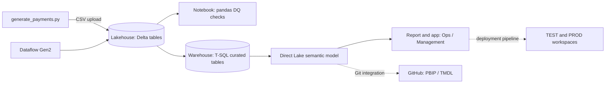
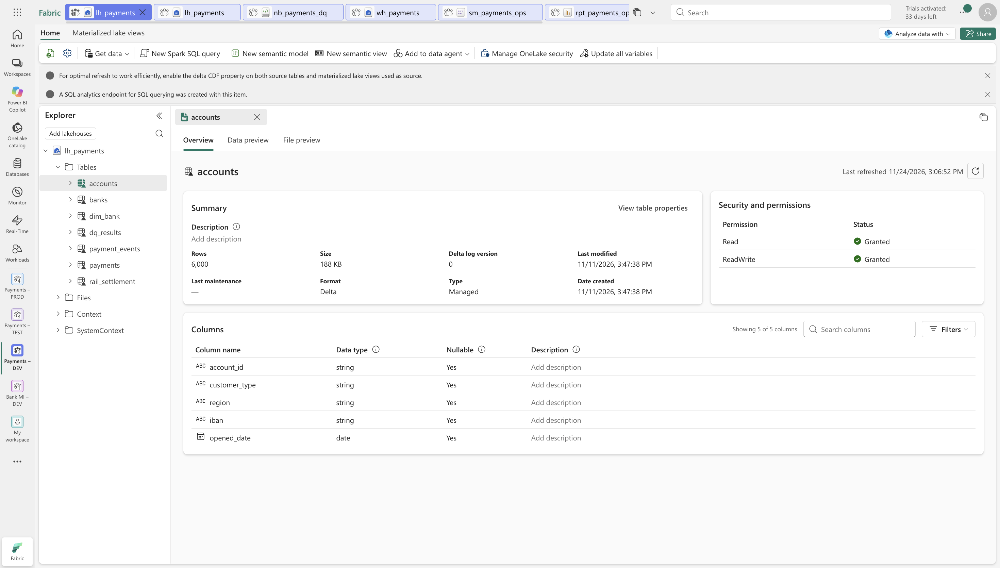
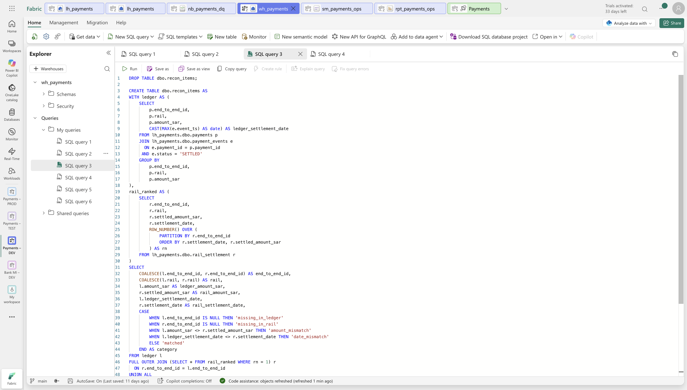
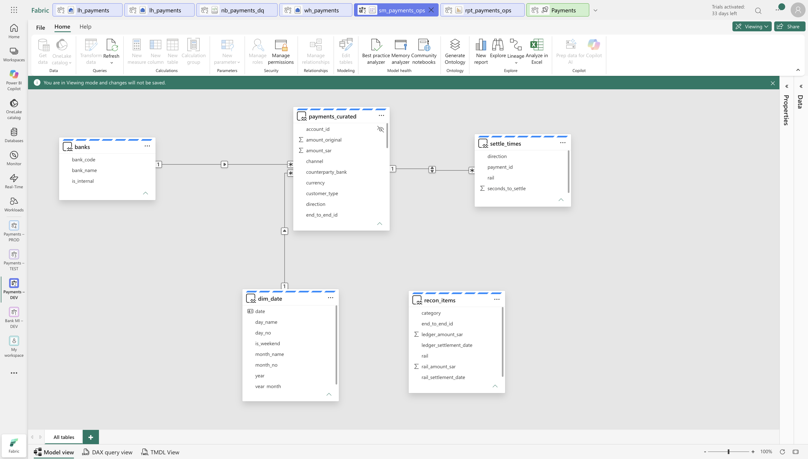
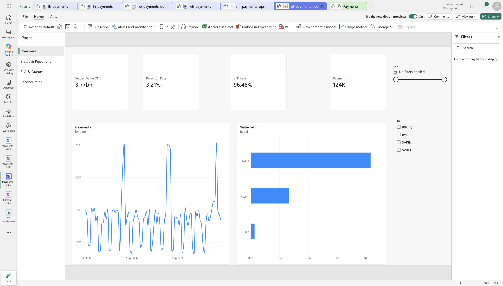
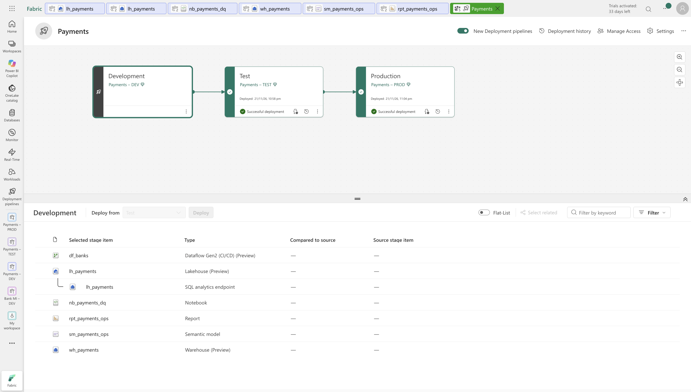

# Payments Operations Analytics (Microsoft Fabric)
**End-to-end payment operations monitoring, automated reconciliation, and Direct Lake analytics on Microsoft Fabric.**

[BRD](docs/BRD.md) · [DQ Report](docs/dq_report.md) · [Reconciliation Report](docs/recon_report.md)

## The Problem
High-volume payment systems process transactions across multiple rails, but delayed failure detection causes settlement breaks and dispute costs. Operations leaders lack real-time visibility across bank rails, transaction velocity, and compliance holds. This solution delivers automated Lakehouse DQ checks, T-SQL reconciliation, and sub-second Direct Lake dashboards to spot and resolve payment anomalies instantly.
## What I Delivered
- **Fabric Lakehouse & Delta Lake**: Raw payment events ingested and validated with automated pandas DQ checks (`docs/dq_report.md`).
- **Warehouse T-SQL Curation**: Dimensional star schema (`dim_account`, `dim_bank`, `dim_rail`, `fact_payment`) with automated ledger-vs-rail reconciliation (`docs/recon_report.md`).
- **Direct Lake Semantic Model**: Zero-latency Direct Lake mode on OneLake Delta tables with 12 DAX business measures (`docs/measures.md`).
- **Power BI Ops App**: 4 interactive pages (Executive Overview, Settlement Breaks, Rail Reliability, Compliance SLA).
- **CI/CD & Governance**: Fabric Git integration (PBIP/TMDL) and deployment pipelines across DEV, TEST, and PROD.

## Architecture

## Screenshots
### 1. Fabric Lakehouse (Delta Tables)

### 2. Warehouse T-SQL Curation & Reconciliation

### 3. Direct Lake Semantic Model

### 4. Power BI Operations App

### 5. Deployment Pipeline (DEV / TEST / PROD)

[Video Walkthrough (4 min)](https://drive.google.com/file/d/1uXbwUBFMC1mH1x08P5FyT6gvpTbgQj56/view?usp=drive_link) · [BRD](docs/BRD.md) · [DQ Report](docs/dq_report.md) · [Reconciliation Report](docs/recon_report.md)

## Key Metrics & Findings
- **High-Throughput Analytics**: 124,283 payments (SAR 1.35B+ volume) across SARIE RTGS, IPS, and SWIFT rails.
- **Straight-Through Processing (STP)**: Monitored STP rates across automated channels; surfaced root causes for manual repair and rejections (e.g. IPS AM02 amount caps).
- **Settlement Velocity & SLAs**: Tracked median settlement time (seconds on IPS vs. multi-hour on SWIFT) and outside-window SARIE queue build-up.
- **Compliance & Hold Monitoring**: Tracked age and volume of compliance holds by rail with strict RLS (only authorized compliance officers view customer-level holds).

## Data Quality & Automated Reconciliation
- **Notebook DQ Suite (`docs/dq_report.md`)**: 8 automated pandas/PySpark checks covering status lifecycle order, timestamp sanity, duplicate detection, and orphan events.
- **T-SQL Reconciliation Engine (`docs/recon_report.md`)**: Automated ledger-vs-rail reconciliation matching 124K ledger records against 119K rail settlement records, classifying breaks into 5 distinct categories:
  - `missing_in_rail` & `missing_in_ledger`
  - `amount_mismatch` (fee deductions)
  - `date_mismatch` (cut-off spillover)
  - `duplicate_in_rail`
## Incident Response & Governance
- **Refresh Incident & Postmortem**: Documented RCA and prevention plan for upstream Lakehouse refresh timeouts and schema drift.
- **Operations Runbook**: Standard operating procedure (SOP) for triaging reconciliation breaks, compliance holds, and rail failovers.
- **CI/CD Lifecycle**: Version-controlled semantic model using Fabric Git integration (PBIP/TMDL) and deployment rules across DEV, TEST, and PROD.

## How to Reproduce
1. Generate payments dataset: run `python python/generate_payments.py`
2. Upload CSVs to Fabric Lakehouse `lh_payments` as Delta tables.
3. Run `notebooks/nb_payments_dq` to validate data quality and log rule results.
4. Run Warehouse T-SQL scripts in `sql/` to build curated tables and reconciliation views.
5. Open `powerbi/` Direct Lake model, connect to your Fabric workspace, and publish the Ops app.

## Project Scope & Limitations
- Synthetic data generated for 124,283 transactions (Jul–Sep 2026) simulating SARIE, IPS, and SWIFT rails.
- Built and tested on Microsoft Fabric trial capacity.

## Author
- **Ancy Aniyan** — Associate Data Analyst | [LinkedIn Profile](https://www.linkedin.com/in/ancyaniyan)
